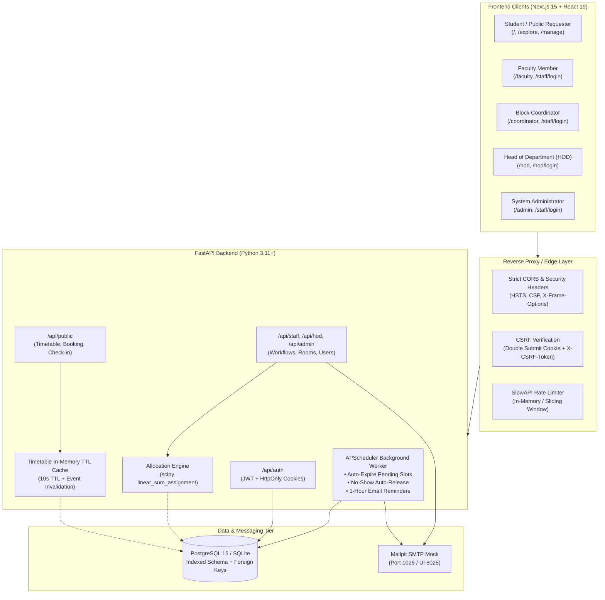

# Smart Classroom — Intelligent Campus Allocation System

A high-performance monorepo platform for automated, conflict-free college classroom and lab scheduling, featuring real-time room availability, multi-tier approvals, Hungarian/Kuhn-Munkres bipartite matching allocation optimization, background expiry & reminders, and granular audit trails.

---

## 🏛️ System Architecture



---

## 📁 Repository Structure

```
smart-classroom/
├── docs/
│   └── SPEC.md               # Complete project specification and functional requirements
├── backend/                  # Python 3.11+ / FastAPI / SQLAlchemy 2.0 / Alembic / APScheduler
│   ├── alembic/              # Database migration versions
│   ├── app/
│   │   ├── api/              # Public, Auth, Admin, Coordinator, HOD API routes
│   │   ├── core/             # Security, DB session, config, scheduler, rate limiting
│   │   ├── models/           # SQLAlchemy ORM models (Bookings, Rooms, Users, etc.)
│   │   ├── schemas/          # Pydantic v2 schemas
│   │   └── services/         # Allocation optimizer, email templates, booking expiry
│   ├── scripts/
│   │   └── seed.py           # Comprehensive database seeder (Departments, Blocks, Rooms, Users)
│   ├── tests/                # Full pytest test suite (80/80 passing)
│   ├── Dockerfile
│   └── requirements.txt
├── frontend/                 # Next.js 15 (App Router) / React 19 / Tailwind CSS / Lucide / Recharts
│   ├── src/
│   │   ├── app/              # Routes: /, /staff/login, /hod/login, /admin, /coordinator, /hod, /faculty
│   │   ├── components/       # UI components, ReactBits animations, dynamic chart loaders
│   │   ├── lib/              # API client, CSRF headers, admin types
│   │   └── middleware.ts     # Edge route protection & session redirection
│   ├── e2e/                  # Playwright end-to-end tests
│   ├── Dockerfile
│   └── package.json
├── docker-compose.yml        # Orchestrates PostgreSQL 16, Mailpit, Backend, and Frontend
├── .env.example              # Central environment template
├── .gitignore
└── README.md
```

---

## 🚀 Quick Start with Docker Compose

Ensure Docker Engine or Docker Desktop is installed and running.

1. **Configure Environment Variables**:
   ```bash
   cp .env.example .env
   ```

2. **Start All Services**:
   ```bash
   docker compose up -d
   ```

3. **Seed Database**:
   ```bash
   docker compose exec backend python scripts/seed.py
   ```

4. **Verify Container Health**:
   ```bash
   docker compose ps
   ```

---

## 💻 Local Development Setup (Manual)

### 1. Backend Setup

```bash
cd backend
python3 -m venv .venv
source .venv/bin/activate
pip install -r requirements.txt

# Run database migrations
alembic upgrade head

# Seed initial departments, blocks, rooms, slots, and users
python scripts/seed.py

# Run backend unit & integration tests
pytest tests/

# Launch FastAPI development server
uvicorn app.main:app --reload --port 8000
```

### 2. Frontend Setup

```bash
cd frontend
npm install

# Run static typecheck & production build
npm run build

# Start Next.js development server
npm run dev

# Run Playwright E2E tests
npx playwright test
```

---

## 🌐 Service Access URLs

| Service | URL | Description |
| :--- | :--- | :--- |
| **Frontend Web App** | [http://localhost:3000](http://localhost:3000) | Public landing page, room search, & booking portal |
| **Backend API Docs** | [http://localhost:8000/docs](http://localhost:8000/docs) | Interactive Swagger UI API documentation |
| **Backend OpenAPI JSON** | [http://localhost:8000/openapi.json](http://localhost:8000/openapi.json) | Raw OpenAPI schema |
| **Backend Health Check** | [http://localhost:8000/api/v1/health](http://localhost:8000/api/v1/health) | Service & database connectivity check |
| **Mailpit Web UI** | [http://localhost:8025](http://localhost:8025) | Local SMTP mailbox inspector (emails & OTPs) |
| **PostgreSQL 16** | `localhost:5432` | Relational database (user: `postgres`, db: `smart_classroom`) |

---

## 🔐 Seed User Credentials

The database seeder (`backend/scripts/seed.py`) provisions standard accounts for testing all approval workflows:

| Role | Email | Password | Department / Assignment |
| :--- | :--- | :--- | :--- |
| **System Admin** | `admin@git.edu` | `Admin@123` | Global Administration |
| **Block Coordinator (Block A)** | `coordinator.block_a@git.edu` | `Coord@123` | Block A - Main Academic |
| **Block Coordinator (Block B)** | `coordinator.block_b@git.edu` | `Coord@123` | Block B - Tech & Computing |
| **Head of Department (CSE)** | `hod.cse@git.edu` | `Hod@123` | Computer Science & Engineering |
| **Head of Department (ECE)** | `hod.ece@git.edu` | `Hod@123` | Electronics & Communication |
| **Faculty Member** | `faculty.cse@git.edu` | `Faculty@123` | Computer Science & Engineering |

> [!NOTE]
> All coordinator and faculty users can log in via `/staff/login`. HODs log in via `/hod/login`. Visiting protected dashboards without credentials redirects users to the appropriate login portal with a return redirect parameter.

---

## ⚙️ Environment Variables Reference

Key environment variables in `.env`:

| Variable | Default Value | Description |
| :--- | :--- | :--- |
| `DATABASE_URL` | `postgresql+psycopg2://postgres:postgres@db:5432/smart_classroom` | Database connection string (or SQLite path) |
| `SECRET_KEY` | `change-this-to-a-super-secret-random-key-in-production` | Secret key for signing JWT tokens |
| `ACCESS_TOKEN_EXPIRE_MINUTES`| `60` | JWT expiration duration in minutes |
| `BACKEND_CORS_ORIGINS` | `["http://localhost:3000","http://127.0.0.1:3000"]` | Allowed CORS origins (must not contain wildcard `*`) |
| `APP_ENV` | `development` | Environment mode (`development` / `production`) |
| `SMTP_HOST` | `mailpit` | SMTP server host |
| `SMTP_PORT` | `1025` | SMTP port |
| `EMAILS_FROM_EMAIL` | `no-reply@smartclassroom.edu` | Outbound sender email address |
| `NO_SHOW_GRACE_MINUTES` | `20` | Grace period before releasing unconfirmed bookings |
| `NEXT_PUBLIC_API_URL` | `http://localhost:8000` | Backend API URL used by frontend client |
| `NEXT_PUBLIC_APP_URL` | `http://localhost:3000` | Frontend web URL used for email hyperlinks |

---

## 📡 REST API Overview

| Method | Endpoint | Description | Auth / Role |
| :--- | :--- | :--- | :--- |
| `GET` | `/api/public/rooms` | Search available rooms with filters & fit scores | Public |
| `GET` | `/api/public/timetable` | Cached multi-day master timetable (10s TTL) | Public |
| `POST` | `/api/public/bookings` | Create public/student booking request | Public (OTP verified) |
| `GET` | `/api/public/bookings/{reference}` | Check status and details of a booking | Public |
| `POST` | `/api/public/bookings/{reference}/cancel` | Cancel an unconfirmed or active booking | Public (Email verified) |
| `POST` | `/api/public/bookings/{reference}/check-in`| Student self-check-in arrival confirmation | Public |
| `POST` | `/api/auth/staff/login` | Staff authentication (Admin, Coordinator, Faculty) | Public |
| `POST` | `/api/auth/hod/login` | HOD authentication portal | Public |
| `POST` | `/api/auth/logout` | Clear session cookies & revoke tokens | Authenticated |
| `GET` | `/api/coordinator/requests` | List pending booking approval requests | Coordinator |
| `POST` | `/api/coordinator/requests/{id}/approve` | Coordinator approve booking | Coordinator |
| `POST` | `/api/coordinator/requests/{id}/reject` | Coordinator reject booking | Coordinator |
| `GET` | `/api/hod/requests` | List lab/special requests requiring HOD review | HOD |
| `POST` | `/api/hod/requests/{id}/approve` | HOD endorse/approve request | HOD |
| `POST` | `/api/admin/allocation/run` | Execute Hungarian bipartite matching optimizer | Admin |
| `GET` | `/api/admin/allocation/metrics` | Retrieve seat utilization & efficiency score | Admin |
| `GET` | `/api/admin/audit-logs` | Query system audit logs with pagination | Admin |

---

## 🧠 Room Allocation Engine & Efficiency Score

The Smart Classroom allocation engine models multi-request classroom assignment as a **Weighted Minimum-Cost Bipartite Matching Problem**, solved in polynomial time via the **Hungarian algorithm** (`scipy.optimize.linear_sum_assignment`).

### 1. Hard Constraints (Feasibility Gate)
A candidate room pair $(R_i, Req_j)$ is considered **infeasible** (assigned a penalty cost of $10^9$) if any of the following are violated:
- **Status**: Room status must be `ACTIVE` (not under `MAINTENANCE`).
- **Capacity**: Room capacity $\ge$ requested expected student strength ($C_i \ge S_j$).
- **Room Type**: Room type must strictly match requested type (`LECTURE_HALL`, `LAB`, `SEMINAR_HALL`, etc.).
- **Required Facilities**: Room must possess all mandatory requested amenities ($F_{req} \subseteq F_{room}$).
- **Clash Prevention**: Room must not have an active timetable schedule, an approved booking, or an administrative block on that specific date and time slot.

### 2. Soft Cost Function
For all feasible pairs, a weighted cost is computed:

$$\text{Cost} = w_{\text{waste}} \cdot \left(\frac{C_i - S_j}{C_i}\right) + w_{\text{dept}} \cdot P_{\text{dept}} + w_{\text{block}} \cdot P_{\text{block}} + w_{\text{dist}} \cdot P_{\text{floor}} + w_{\text{split}} \cdot P_{\text{split}}$$

- **Capacity Wastage ($w_{\text{waste}} = 40.0$)**: Penalizes allocating an oversized room (e.g., placing 25 students in a 120-seat hall).
- **Department Ownership ($w_{\text{dept}} = 20.0$)**: Prioritizes departmental home rooms/labs for their own faculty and students.
- **Block Match ($w_{\text{block}} = 20.0$)**: Minimizes cross-campus travel away from the department's home block.
- **Floor Distance ($w_{\text{dist}} = 10.0$)**: Penalizes excessive vertical displacement between consecutive sessions.
- **Split Penalty ($w_{\text{split}} = 10.0$)**: Penalizes relocating back-to-back classes of the same cohort across disparate blocks.

### 3. Efficiency Score Formula (0 – 100 Composite Index)
When evaluating an allocation plan, the system computes an aggregate **Efficiency Score** weighted across five dimensions:

$$\text{Efficiency Score} = 0.25 \cdot E_{\text{alloc}} + 0.30 \cdot E_{\text{seat}} + 0.20 \cdot E_{\text{fac}} + 0.15 \cdot E_{\text{pref}} + 0.10 \cdot E_{\text{block}}$$

$$\begin{aligned}
\text{Where:} & \\
E_{\text{alloc}} &= \text{Allocation Rate \%} = \frac{\text{Allocated Requests}}{\text{Total Requests}} \times 100 \\
E_{\text{seat}} &= \text{Seat Utilization \%} = \frac{\sum \text{Expected Strength}}{\sum \text{Allocated Room Capacity}} \times 100 \\
E_{\text{fac}} &= \text{Facility Match \%} = \frac{1}{N} \sum_{k=1}^N \frac{|F_{req} \cap F_{room}|}{|F_{req}|} \times 100 \\
E_{\text{pref}} &= \text{Preference Satisfaction \% (Department, Block, and Floor alignment)} \\
E_{\text{block}} &= \text{Block Continuity Index} = \max\left(0, 100 - \frac{\text{Cross-Block Switches}}{\text{Total Allocations}} \times 100\right)
\end{aligned}$$

> [!CAUTION]
> **Zero-Tolerance Conflict Constraint**: If any double-booking, overcapacity violation, or maintenance clash is detected in the generated plan ($\text{Conflict Count} > 0$), the efficiency score is immediately forced to **`0.0`**.

---

## 📸 Screenshots & Previews

<!-- slide -->
### 1. Student Real-Time Availability & Booking Portal
```
+-----------------------------------------------------------------------------------+
|  [Smart Classroom]   Home   Timetable   Manage Booking       [Theme: Dark] [Staff] |
|                                                                                   |
|    Find & Book Conflict-Free College Classrooms                                  |
|    [ Date: 2026-10-15 ] [ Slot: 09:30 AM - 10:30 AM ] [ Strength: 60 ] [ Search ]  |
|                                                                                   |
|  +--------------------+ +--------------------+ +-------------------------------+ |
|  | LH-101 (Block A)   | | CS-Lab 2 (Block B) | | Audi-1 (Block D)              | |
|  | Fit Score: 98%     | | Fit Score: 94%     | | Fit Score: 85%                | |
|  | Capacity: 65 seats | | Capacity: 70 seats | | Capacity: 120 seats           | |
|  | [ Book Classroom ] | | [ Request Lab ]    | | [ Book Classroom ]            | |
|  +--------------------+ +--------------------+ +-------------------------------+ |
+-----------------------------------------------------------------------------------+
```
*(Placeholder for landing page and booking modal screenshot: `docs/screenshots/01-landing-booking.png`)*

<!-- slide -->
### 2. Coordinator & HOD Two-Tier Approval Console
```
+-----------------------------------------------------------------------------------+
|  Block Coordinator Console  --  Block A (Main Academic)                          |
|  [Pending Requests: 3] [Approved Today: 12] [Conflicts: 0]                        |
|                                                                                   |
|  Reference   Requester       Room / Slot               Status       Action        |
|  REQ-98124   Aarav Patel     LH-101 (09:30 - 10:30)    PENDING      [Approve] [X] |
|  REQ-98125   Dr. Sen (CSE)   CS-Lab 1 (11:45 - 12:45)  HOD_APPROVED [Approve] [X] |
+-----------------------------------------------------------------------------------+
```
*(Placeholder for coordinator and HOD console screenshot: `docs/screenshots/02-approval-console.png`)*

<!-- slide -->
### 3. Admin Optimization & Allocation Analytics
```
+-----------------------------------------------------------------------------------+
|  Intelligent Classroom Allocation Optimizer                                       |
|  Efficiency Score: 94.2 / 100  |  Seat Utilization: 88.6%  |  Wastage: 11.4%      |
|                                                                                   |
|  [ Recharts: Seat Utilization vs Wastage ]  [ Recharts: Block Distribution ]      |
|  [ Run Optimizer (scipy bipartite) ]       [ Export Allocation Schedule (CSV) ]   |
+-----------------------------------------------------------------------------------+
```
*(Placeholder for admin analytics dashboard screenshot: `docs/screenshots/03-admin-analytics.png`)*

---

## 🧪 Testing & Verification

- **Backend Unit & Integration Tests**:
  ```bash
  cd backend && pytest tests/ -v
  # 80 passed in 15.52s
  ```
- **Frontend End-to-End Tests**:
  ```bash
  cd frontend && npx playwright test
  ```
- **Type Checking & Production Build**:
  ```bash
  cd frontend && npm run build
  # 22/22 routes successfully compiled
  ```

---

## 📄 License & Contribution

Distributed under the MIT License. Developed for smart campus operations and automated classroom allocation.
