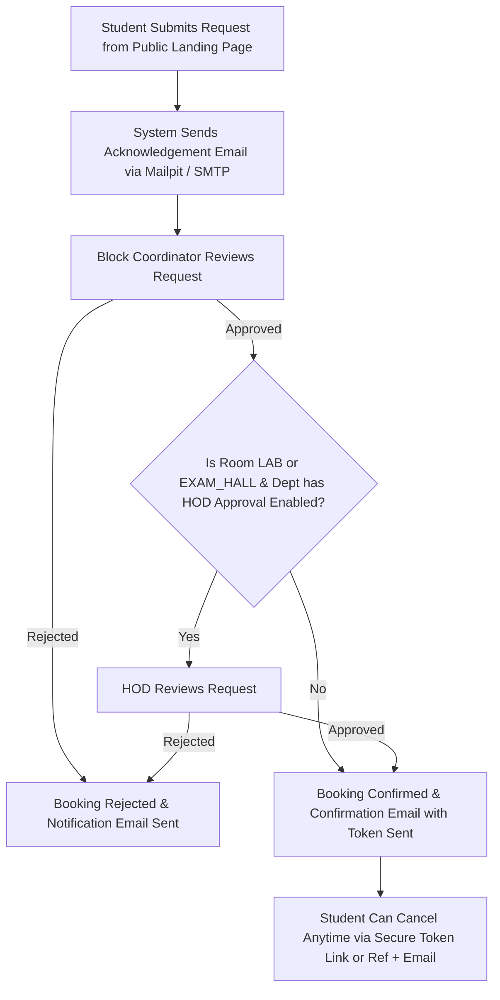

# Smart Classroom Allocation System — Project Specification

## 1. Project Overview
**Smart Classroom Allocation System for a College**

A centralized, automated, and rule-driven room allocation platform for classrooms, laboratories, seminar halls, and exam halls. The system is designed to maximize utilization, prevent scheduling conflicts, streamline multi-tier approval workflows, and deliver a seamless experience for students, faculty, department heads, and administration.

---

## 2. Roles & Permissions

| Role | Access & Scope | Authentication |
| :--- | :--- | :--- |
| **Student** | **Public Access (No Login Required)**. Books rooms directly from the public main landing page. Requires Roll No, Name, Department, Class/Section, Phone, and Email. Can track status or cancel using secure token link or Booking Ref + Email. | None (Public Form) |
| **Faculty** | Staff account for booking departmental or general rooms and tracking academic requests. | Staff Login (`/staff/login`) |
| **Coordinator** | Assigned per physical block (one or more per block). Reviews, approves, or rejects booking requests within their block. | Staff Login (`/staff/login`) |
| **HOD** | Head of Department. Reviews approval requests for department-managed rooms (Labs, Exam Halls when "HOD approval" is enabled). | Dedicated HOD Login (`/hod/login`) |
| **Admin** | Full system control: room catalog, department settings, user management, toggle HOD approval requirements, monitor baseline vs. allocation efficiency metrics. | Staff Login (`/staff/login`) |

---

## 3. Room Categories & Metadata

### Room Types
- `CLASSROOM`: Standard lecture halls and classrooms.
- `LAB`: Departmental laboratories (Computer, Electronics, Mechanical, etc.).
- `EXAM_HALL`: High-capacity assessment halls.
- `SEMINAR_HALL`: Auditoriums and presentation halls with AV equipment.

### Room Attributes
- **Name / Room Number**: Unique identifier (e.g., `A-201`, `CS-LAB-01`).
- **Block**: Physical building/wing (e.g., Block A, Science Block, Mechanical Wing).
- **Floor**: Floor number.
- **Capacity**: Maximum seat count.
- **Facilities**: Tagged amenities (`projector`, `ac`, `smart_board`, `pcs`, `mic`, `sound_system`, `lab_equipment`, etc.).
- **Department**: Optional departmental affiliation (required for Labs / department-owned venues).
- **Status**: `ACTIVE` or `MAINTENANCE`.

---

## 4. Booking Lifecycle & Approval Flow

1. **Submission**: Student enters Roll No, Name, Department, Class, Phone, Email, selects desired slot, capacity, and facility requirements.
2. **Acknowledgement**: Immediate acknowledgement email dispatched with booking reference and secure tracking token.
3. **Block Coordinator Approval**: The assigned coordinator for the designated block reviews and approves or rejects the request.
4. **HOD Approval (Conditional)**: If the room is a `LAB` or `EXAM_HALL` and the department has the "HOD Approval" toggle turned on by the Admin, the HOD must also approve before final confirmation.
5. **Confirmation**: Final confirmation email is sent containing event details, room assignment, and a secure cancellation link.
6. **Cancellation**: Students can cancel any active booking anytime using the secure token link or Booking Reference + Email verification.

---

## 5. System Rules & Integrity

- **Strict No Double-Booking (DB-Level Constraint)**:
  Overlapping bookings for the same room and time slot are prevented at the database level using PostgreSQL exclusion constraints / transactional locking (`tstzrange` or composite unique constraints).
- **Maintenance & Exam Blockouts**:
  Rooms under `MAINTENANCE` or scheduled for institutional exam blocks are strictly unavailable.
- **Dynamic Re-allocation Suggestions**:
  When a room enters maintenance or becomes unavailable, the system automatically suggests the best alternate active rooms matching capacity and facilities.

---

## 6. Allocation Efficiency & Scoring Engine

The platform measures and scores room allocation quality against a naive first-fit baseline across key metrics:
- **Capacity Utilization**: Ratio of attendees to room capacity (penalizing gross over-capacity bookings).
- **Space Wastage**: Minimizing empty seats in high-demand halls.
- **Facility Match Score**: Precise matching of required facilities without tying up unnecessary high-tier resources.
- **Preference Satisfaction**: Proximity to student/faculty department and block preference.
- **Unallocated Count**: Minimizing rejected or unserviced valid requests.

---

## 7. Authentication & Session Management

- **Separate HOD Portal**: Dedicated login at `/hod/login`.
- **Shared Staff Portal**: Shared login at `/staff/login` for Admin, Coordinators, and Faculty.
- **Smart Redirects**: Logged-in users attempting to access login routes are automatically redirected to their role-specific dashboard.
- **Session Security**: Expiring sessions (JWT in HTTP-only cookies) requiring re-authentication.
- **Password Recovery**: Secure OTP sent via email (captured in local development via Mailpit).

---

## 8. User Interface & Design System

- Modern, sleek, high-conversion UI with smooth animations.
- System light / dark mode support with instant theme switching.
- React Bits components for interactive widgets, cards, and buttons.
- Animated background / particle mesh hero section on the public landing page.
- Responsive design tailored for mobile phones, tablets, and desktop displays.

